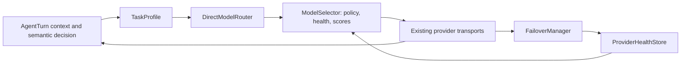

# A10.5 intelligent multi-model routing and provider failover

Date: 2026-10-20. A10's compound controller, receipts, grounding/freshness, semantic completion, Windows executor and recovery remain frozen. A11 was not started. This phase changes reasoning-provider selection and its integration hooks.

## A10.5 IMPLEMENTATION SUMMARY

Implementation is present and deterministic routing contracts pass. Successful live response completion after failover remains unproven: the single bounded probe attempted NVIDIA and Gemini after an injected Groq quota failure, but neither returned a usable answer. Implementation readiness and live acceptance are separate in this report.

## ROUTER ARCHITECTURE

The existing `DirectModelRouter` remains the canonical provider router; no parallel provider registry or prompt router was introduced.

`routing_profiles.py` defines task/model/provider metadata; `model_selection.py` filters and scores; `provider_failover.py` classifies failure and retry scope; `provider_health.py` owns observed health/persistence. `gemini_route.py` adapts the existing Gemini transport. AgentTurn retains exclusive action execution and verification authority.

## TASK PROFILE

Structured fields: category, complexity, tool/structured-output/computer-use/code/vision requirements, long-context requirement, estimated context size, latency priority, background allowance, privacy class, and target device. Inputs come from existing context, canonical capabilities, declared UI success conditions, and optional `AgentDecision.routing_hints`.

There is no extra classification API call and no user-word inspection. A cold request with no task metadata starts with a general/unknown-complexity interactive profile; the router does not pretend to know its unseen complexity. Existing semantic decisions can guide subsequent reasoning or interpretation. The last task profile is persisted for explicit same-task resume. Hints cannot grant approval, authorize an executor, or lower the effective privacy class.

## MODEL PROFILE

Fields include provider/model IDs, modalities, Cortex structured decision/tool support, structured output, context window, relative reasoning/coding/computer-use/tool-reliability hints, expected latency, interactive/background suitability, and configured preference.

Strengths and expected latencies are qualitative routing priors, not measured benchmark scores. Successful-call latency observations supersede latency hints. Default context windows are unknown (`null`), rather than fabricated limits. Ordinary bounded requests can use an unknown window; explicitly long-context requests require verified configured capacity. A context failure tries an eligible model with a known larger window, and otherwise fails truthfully. Existing compression still applies; the router does not strip evidence or restrictions to force a request through.

Optional `CORTEX_MODEL_PROFILE_PATH` reads a bounded JSON array of complete ModelProfile records. Only configured canonical transports become candidates; a profile cannot enable a new API endpoint or override provider privacy restrictions. A transport must also implement an advertised image modality. Unknown metadata remains unknown.

## PROVIDER PROFILE

Provider identity, configured availability, locality and maximum data class are derived from instantiated provider implementations. Existing `direct_provider.PROVIDERS` retains endpoint/model allowlisting. Credentials are not profile fields and are neither copied to routing events nor persisted in health state. Missing credentials remove the provider; invalid configuration for one provider does not disable other valid configured providers.

## RANKING / SELECTION METHOD

Each reasoning call recomputes eligibility and ranking. Rejections include missing configuration, unsupported modality/tool/schema, insufficient or unknown required context capacity, privacy/terms/approval restrictions, active cooldown/quota state, already-attempted candidate, or provider failure during the same call.

Inspectable score components are capability fit, reasoning fit, coding fit, computer-use/tool fit, expected latency, recent reliability, quota pressure, provider health, configured preference and interaction fit. High-complexity metadata increases reasoning weight; coding metadata increases coding fit; computer-use loops weight tool quality and latency; background work tolerates slower candidates. No model name directly determines a task route.

Public/internal calls can change model/provider after ranking. Explicit private sharing authorization remains bound to its recipient and approved data class. Model selection never resets or reconstructs an AgentTurn.

## PROVIDERS INTEGRATED

- Groq direct chat-completions transport.
- NVIDIA direct transport, retaining the existing explicit trial opt-in and PUBLIC-only restriction.
- Gemini's existing SDK transport, adapted to the same ranking/health/failover protocol when its key is configured.
- Existing Ollama/private classification routing remains available through the existing wrapper; an explicit local-only policy is not silently replaced by cloud routing.

`CORTEX_LLM_PROVIDER=direct` uses configured eligible providers. Explicit single-provider modes remain intentional restrictions. The user's current mode was confirmed as `direct`; credentials and trial settings were not modified. Restart the hub to load the updated code; this task did not restart an active user runtime.

## MODELS INTEGRATED

| Provider | Models | Routing constraints |
|---|---|---|
| Groq | qwen/qwen3.8-27b, openai/gpt-oss-120b | Existing transport/model allowlist, privacy engine, observed health |
| NVIDIA | deepseek-ai/deepseek-v4.1-flash, z-ai/glm-5.3 | Key plus explicit trial enablement; PUBLIC only |
| Gemini | CORTEX_GEMINI_MODEL, existing default gemini-3.8-flash | Configured key; text/structured reasoning adapter; no unimplemented image projection advertised |

These are configured candidates, not claims that every endpoint is currently healthy or that the hints constitute a model leaderboard. NVIDIA cannot receive INTERNAL computer state or private UI snapshots just because other providers are unavailable. AgentTurn's effective privacy classification remains authoritative.

## FAILURE CLASSIFICATION

Operational failure classes cover model-specific failure, provider-specific failure, rate limit, daily quota exhaustion, temporary cooldown, timeout, authentication/configuration failure, invalid request, privacy ineligibility, context capacity, and unsupported tool use.

Classification prioritizes typed HTTP status/error codes and safely extracted quota metadata. SDK `code` and transport `status_code` are both retained when valid. Legacy user-facing categories remain compatible (for example RATE_LIMIT_429), while routing events identify DAILY_QUOTA_EXHAUSTED separately. Raw provider bodies and exception text are not recorded in routing events. Preflight context uncertainty does not falsely claim a provider rejected an unsent request.

## SAME-PROVIDER FALLBACK

Model-specific tool/structured-output failures can select another eligible model on the same provider. Explicit model-scoped quota metadata also limits only that model. A model's tool declaration cannot bypass registry/schema validation or native action policy.

## CROSS-PROVIDER FAILOVER

Provider-scoped failure excludes sibling models for that reasoning call and recomputes candidates across other eligible providers. Unknown quota-sharing scope is conservatively treated as a provider exclusion policy; it is not asserted as a discovered account-wide limit. Factual quota units and unreported balances remain separate observations.

No candidate is normally attempted more than once. The bounded maximum is six candidate attempts. Only an explicit transient Retry-After permits a candidate revisit: at most two safe retries, within the existing wait budget. Daily exhaustion and authentication errors never enter that short retry loop. A bad request stops rather than repeating the same invalid payload. Callbacks are emitted only for an authoritative successful result.

## QUOTA HANDLING

Actual response headers and numeric provider metadata supply limits, used/remaining balances, scope and reset information. Local token estimates and request reservations do not manufacture a quota limit. An authoritative zero balance suppresses further selection until reset/knowledge expiry. Near-exhaustion affects preference when enough metadata exists; unknown is not zero.

A late response from an already-admitted concurrent request cannot erase a newer active daily quota/auth restriction or replace daily recovery with a minute reset. Provider and model scopes remain separate. Production restrictions come from the canonical health store; the legacy manual Route cooldown field remains compatibility input only.

## COOLDOWN HANDLING

Provider/model health can be unknown, healthy, degraded, cooldown, quota_exhausted, or unavailable. Eligible alternatives are tried before waiting. If none remains, the task enters the existing WAITING_FOR_PROVIDER path. Unconfigured or cooling-down providers do not trigger pointless sharing-approval prompts.

Interactive attempts have a bounded 12-second ceiling within the existing lane budget; background attempts may use 45 seconds within a 60-second active budget. These per-attempt limits are now passed to the HTTP/SDK transport too. Safe Retry-After waits are bounded and visible through the existing provider-wait hook. The router does not retry OS actions.

## PRIVACY-AWARE ROUTING

Every candidate is checked against the existing PrivacyPolicyEngine and its transport's maximum data class. NVIDIA's PUBLIC restriction is unchanged and cannot be overridden by a cloud-sharing approval. Highly sensitive data cannot move to a cloud fallback. Policy is rechecked between attempts; revocation and a stronger data class invalidate a cached private grant. Caller-supplied user_approved flags are not router authorization.

AgentTurn binds private approval locally after its existing confirmation gate. That recipient/model binding survives provider failure: the router waits rather than silently transferring private evidence to another model. Explicit local-only policy remains local. No eligibility fix strips privacy annotations or removes sensitive evidence to obtain a response.

## ACTION REPLAY PROTECTION

The router retries only inference with the same bounded history/evidence and request/task context. AgentTurn continues to own side effects, durable receipts, observations and verification. New tests run the actual AgentTurn/control/checkpoint path: action success -> provider failure -> another model receives the persisted result -> completion without another dispatch. A fallback model proposing the same action is rejected by A10's unchanged duplicate guard. If all providers fail after execution, the receipt survives and the task waits truthfully.

## RESTART PERSISTENCE

Relevant health is atomically stored in `CORTEX_STATE_DIR/provider-health.json` (default the user's .cortex directory), with bounded rows and validated measurements. It records last success/failure/category, cooldown, known quota/reset metadata, average latency and recent counts. Request reservations and prompt content are not persisted there.

Explicit resets expire automatically. Without a real reset, quota_reset_at stays null; a bounded local knowledge expiry is not presented as a service reset. Stale statistics/degraded status clear after retention. Corrupt/unavailable persisted state falls back to unknown and logs a safe diagnostic. Restart tests reload the actual file and advance an injected clock; they do not claim a live multi-process outage demonstration.

## ROUTING OBSERVABILITY

Task-local `routing_events` contain structured task profiles, ranked/rejected candidates with reasons, score components, selected model/provider, failover class/scope, observed health, actual HTTP status when available, wait events and final outcome. Events are bounded to 128 and preserve task/parent identity. Router status and the last routing event are available through existing authenticated control-state output.

No raw user prompt, provider response body, hidden reasoning, credentials, screenshot or typed text is included in these events or provider-health files. Existing private local AgentTurn evidence is stored separately under existing policy.

## HARDCODING AUDIT

No new phrase trees, app-specific routes, benchmark handlers, or prompt-keyword classifier were added. New routing modules contain no Calculator/Notepad/Downloads/weather/CPU scenarios or OpenRouter dependency. Model IDs appear only in transport configuration and qualitative profile metadata. Canonical capability-family checks and state/privacy/error handling are deterministic protocol logic.

This is a scoped audit of the routing changes, not a claim that every legacy helper elsewhere in Cortex has been removed. A10 native controller/executor/receipt/recovery mechanisms were not broadly refactored.

## NEW TESTS

The dedicated `tests/test_a10_5_routing.py` covers structured interactive/complex/coding/background/computer-use choice, observed latency/quota pressure, tool/modality/context eligibility, same-provider fallback, provider-wide daily quota failover, timeout, authentication, invalid request, explicit cooldown/reset, unknown quota, restart persistence, no eligible provider, public/private policy, approval scope/revocation, successful-action continuation and rejected replay, bounded attempts, safe callbacks/cancellation, safe events, configuration, Gemini managed retry/TTFT, actual HTTP/SDK deadline projection, and late-success quota races.

### Baseline fixture migrations

| Existing test | Reason and retained invariant |
|---|---|
| test_quota_fallback_keeps_context_and_pins_winner | Its synthetic 429 now explicitly declares model scope. It still proves same-provider alternate selection, unchanged conversation context, winner retention while the failed model is blocked, and one request to that failed model. Provider-wide quota now has separate cross-provider assertions. |
| test_personal_or_approved_data_never_switches_recipient[PERSONAL/SENSITIVE] | The assertion covers selection as well as execution because policy-ineligible PERSONAL data can now be rejected before creating a selected recipient. No alternate request is allowed. |
| test_factory_requires_configuration_and_explicit_trial_opt_in | Clears unrelated Gemini credentials so it tests exactly the stated Groq/NVIDIA configuration. Missing keys and NVIDIA opt-in assertions remain. |
| test_invalid_model_configuration_reports_unavailable | Clears unrelated Gemini/NVIDIA keys. A sole invalid provider remains unavailable; a new test separately proves one bad provider does not disable a valid one. |
| test_screen_analysis_sends_image_and_fails_on_invalid_observation | Explicit policy allows cloud sharing of the synthetic screenshot fixture. Image identity, transport, parsing and invalid observation assertions remain; unapproved sharing is not used to make the fixture pass. |
| test_provider_requested_wait_retries_only_reasoning; test_multiple_actual_rate_replies_wait_within_budget_without_action_replay | The simulated wait now advances the health store's clock too. Same payload, bounded waits and exact request/no-action-replay assertions remain. |
| test_gemini_has_no_implicit_backup | Explicit Gemini mode now uses the canonical router. Assert exactly one Gemini route instead of the retired circuit-breaker's fallback attribute; the no-implicit-recipient invariant is preserved. |

No meaningful test was deleted, skipped, xfailed, or made unconditional. The external-network guard remains unchanged.

## FULL REGRESSION RESULT

**668 passed / 0 failed / 0 skipped / 0 xfailed**, 111.57 seconds, two existing dependency deprecation warnings. All **621 baseline identities** remain passing, with **47 added checks**. Evidence: `C:\Users\abhin\Documents\Codex\2026-10-15\referenced-chatgpt-conversation-this-is-an\work\a10_5\signoff.xml`, `signoff.txt`, `suite-manifest.json`, and `verification-summary.json`. The existing external-network guard, production database and A10 live prompts remain unchanged.

The final consolidated gate retains all 621 baseline identities and adds the dedicated routing checks. It includes A1-A10, architecture repair, AgentTurn, GUI/runtime controls, background/recovery, privacy, context compression, provider routing and local TLS transfers. Raw XML/log and baseline comparison are in the task's work/a10_5 artifact folder. Only existing dependency deprecation warnings are expected.

## LIVE FAILOVER RESULT

**INCONCLUSIVE — no healthy alternate response was completed.** One controlled routing-only validation ran after an offline clean gate. Groq quota exhaustion was injected locally with MockTransport; no real Groq request was sent. The selected real providers were NVIDIA/DeepSeek and then Gemini. Exactly one invocation of each occurred. NVIDIA timed out under the then-existing 30-second transport limit; Gemini reported SERVICE_UNAVAILABLE_503. Both task and parent IDs stayed intact. Highly sensitive fallback was rejected with zero additional provider invocations.

The probe exposed two general issues corrected afterward using offline tests: SDK HTTP status metadata retention and the mismatch between the router's background allowance and its transport deadline. No live rerun was made after those corrections. The original probe artifacts are preserved and a started marker prevents accidental automatic repetition. No live OS task, compound acceptance case, microphone flow, or 18-case benchmark was run.

Evidence: `live-failover.json`, `live-probe.txt`, and the isolated live-probe database/health file in work/a10_5. Synthetic quota state was never written into the production provider-health store. A routing attempt is not presented as a successful returned answer.

## A10.5 COMPLETE YES/NO

**NO for full live acceptance.** The implementation and offline gate are complete; a successful returned response through live failover remains pending. This verdict avoids treating attempted failover or fixture success as proof of healthy real-provider completion.

## READY FOR A11 YES/NO

**NO.** A11 was not started. A10's implementation remains complete/frozen, while its healthy-provider compound acceptance remains PENDING_PROVIDER_CAPACITY.

## REMAINING VALIDATION DEBT

1. One successful public live fallback response after provider capacity is healthy, using a new evidence directory and the same bounded request policy. Preserve the current failed/inconclusive evidence; do not repeat broad probes while providers are blocked.
2. The existing three-case healthy-provider A10 compound acceptance gate, unchanged prompts and manual semantic review. No new blind benchmark score is claimed.
3. Real-model quality/latency calibration and verified context-window metadata for the operator's configured models. First-turn unknown complexity and unknown context limits are explicit limitations, not hidden natural-language rules.
4. Live success after the corrected background deadline projection. Offline tests prove transport configuration and SDK schema compatibility, not that a timed-out server would have answered within the longer budget.

No credentials were changed, no user runtime was restarted, and no commit or push was performed.
